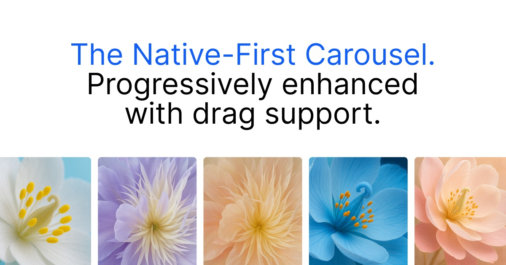

# Blossom Carousel

<p>
<a href="https://www.npmjs.com/package/@numbered/carousel"></a>
<a href="https://bundlephobia.com/package/@numbered/carousel"></a>
</p>

The native-first carousel enhanced with drag support.

➥ [www.blossom-carousel.com](http://www.blossom-carousel.com)

This is Numbered's fork of [jespervos/blossom-carousel](https://github.com/jespervos/blossom-carousel), published under `@numbered/*`. See [what the fork adds](#what-this-fork-adds).

## Why Blossom?

<ul style="list-style: none; padding: 0;">
<li>🥇 <strong>Native scrolling</strong>: Full performance and accessibility.</li>
<li>🚀 <strong>Dragging</strong>: Custom physics-based dragging for mouse and trackpad.</li>
<li>✨ <strong>No abstraction</strong>: use all native web API's.</li>
<li>💡 <strong>Configure with CSS</strong>: Works with native scroll-snap, position sticky and scroll-driven animations.</li>
<li>🪶 <strong>0kb on touch devices</strong>: the Vue and Svelte components, and the core's lazy-loading pattern, only download the engine when a fine pointer device is detected.</li>
<li>🧭 <strong>Navigation</strong>: <code>prev()</code>, <code>next()</code> and a <code>change</code> event, aligned by your CSS snap settings.</li>
<li>↕️ <strong>Both axes</strong>: Horizontal or vertical, switchable per breakpoint with one DOM.</li>
<li>🧱 <strong>Works with major frameworks</strong>: Components for React, Vue, Svelte, Alpine.js and Web Components.</li>
</ul>

## Installation

Every package needs the core stylesheet, `@numbered/carousel/style.css`.

### React

[React Docs](./packages/react)

```bash
npm install @numbered/carousel-react @numbered/carousel
```

### Vue

[Vue Docs](./packages/vue)

```bash
npm install @numbered/carousel-vue @numbered/carousel
```

### Svelte

[Svelte Docs](./packages/svelte)

```bash
npm install @numbered/carousel-svelte @numbered/carousel
```

### Alpine.js

[Alpine.js Docs](./packages/alpine)

```bash
npm install @numbered/carousel-alpine @numbered/carousel
```

### Web Component

[Web Component Docs](./packages/web)

```bash
npm install @numbered/carousel-web @numbered/carousel
```

### Core

[Core Docs](./packages/core)

```bash
npm install @numbered/carousel
```

## What this fork adds

Compared with upstream at the fork point ([`fd84d1e`](https://github.com/jespervos/blossom-carousel/commit/fd84d1e), September 2025):

- **Navigation**: `prev()`, `next()` and `currentIndex()`, plus a bubbling `change` event with `detail.index`. Targets follow each slide's `scroll-snap-align` (`start`/`center`/`end`), `scroll-margin`, the carousel's `scroll-padding` and RTL.
- **Vertical carousels**: the axis follows the carousel's CSS overflow, so one element can be horizontal on mobile and vertical on desktop. Drag, momentum, rubber band, keyboard and navigation all follow it.
- **Native snapping at rest**: trackpad, wheel and keyboard scrolls snap natively; physics only takes over snapping while it moves the carousel.
- **Repeat mode**: seamless wrapping in both directions, loop length measured from the slides (gaps, grid tracks), no ping-pong at the edges. Horizontal only.
- **Touch devices**: scrolling stays native and navigation uses `scrollIntoView`. React and Alpine skip initialising the engine there but still bundle it; Vue and Svelte don't download it.
- **Performance and lifecycle**: no layout thrash on scroll or resize, a ticker that stops once settled, frame-rate independent friction, slides re-measured when they resize, and a `destroy()` that undoes everything so `init()` can run again.
- **Wrappers**: an Alpine.js plugin; React `repeat`, `load`, `onChange`, `ref` (navigation) and `elementRef` props; Vue `repeat` prop and exposed navigation methods.
- **Tests**: a browser test suite for the core (see [Development](#development)).

### Wrapper support

| Package | `repeat` | `load="always"` | `change` | `prev()` / `next()` / `currentIndex()` |
| --- | --- | --- | --- | --- |
| React | ✓ | ✓ | `onChange` prop | `ref` |
| Vue | ✓ | ✓ | `@change` | template ref |
| Svelte | ✓ | ✓ | listener on a parent element | - |
| Alpine.js | ✓ | ✓ | `currentIndex` | `prev()` / `next()` in scope |
| Web Component | - | always loads | listener on the element | - |

## Examples

- [Simple](https://www.blossom-carousel.com/docs/examples#simple)
- [Variable widths](https://www.blossom-carousel.com/docs/examples#variable-widths)
- [CSS Grid](https://www.blossom-carousel.com/docs/examples#css-grid)
- [Multiple rows](https://www.blossom-carousel.com/docs/examples#multiple-rows)
- [Snapping](https://www.blossom-carousel.com/docs/examples#snapping)
- [Grouping](https://www.blossom-carousel.com/docs/examples#grouping)
- [Sticky](https://www.blossom-carousel.com/docs/examples#sticky)
- [Coverflow](https://www.blossom-carousel.com/docs/examples#cover-flow)

## Development

A [bun](https://bun.sh) workspace:

```bash
bun install
bun run dev     # sandbox (packages/dev); dev:react, dev:vue, dev:svelte, dev:alpine, dev:web for each package
bun run build   # every package
```

The core's browser test suite opens with `bun run test` in `packages/core`; the page title reads "ALL PASS" when every case passes. It needs a real browser, so it isn't part of CI.
